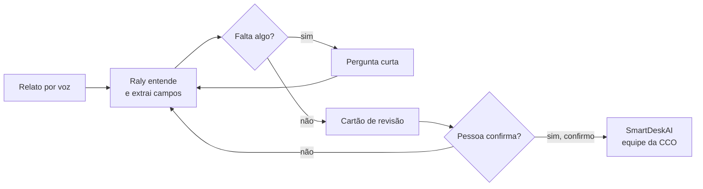

<div align="center">

# Raly

### Fale. O Raly organiza.

Agente de voz para quem trabalha em rodovias, com três agentes e acesso por perfil.


**Challenge Motiva · FIAP · Front End & Mobile Development · Turma 2TIAPR**

Repositório: https://github.com/fiap-projectxs/Sprint-1---Front-End-Mobile-Development

</div>

> **Projeto em desenvolvimento.** O site e o código estão em construção e mudam a cada entrega. Os dados são fictícios e nada aqui é produto final.

**Sumário:** [O que é](#o-que-é) · [Agentes](#os-três-agentes-e-quem-usa-cada-um) · [Fluxo](#como-funciona-o-fluxo) · [Como rodar](#como-rodar) · [Acesso](#contas-e-níveis-de-acesso) · [Estrutura](#estrutura) · [Deploy](#deploy-railway) · [Limitações](#limitações)

## O que é

O **Raly** é um agente de **voz** para quem trabalha em rodovias (inspeção de tráfego, guincho, APH). O profissional fala o relato de uma ocorrência, sem digitar e sem tirar a atenção da via. O Raly organiza o que foi dito em campos claros, marca o que veio do relato e o que ainda falta, pergunta uma coisa por vez e entrega um resumo para **uma pessoa revisar e confirmar**.

O Raly **não decide gravidade, não aciona equipes e não inventa dados**: ele organiza informação e deixa a decisão com pessoas autorizadas.

## Os três agentes e quem usa cada um

O projeto reunia quatro frentes, mas um único grupo não consegue cobrir todas com a mesma profundidade. Por isso o grupo **escolheu um público para cada uma e retirou uma delas**. Essa divisão **mudou em relação à Sprint 1** e vale daqui para frente:

| Agente | Público escolhido | Papel na operação |
| --- | --- | --- |
| **Raly** | **Profissional de trânsito nas rodovias** (inspeção de tráfego, guincho, APH) | Agente de voz do campo: recebe o relato, extrai campos, pergunta o que falta e prepara o cartão de revisão. É o foco da Sprint 2 (trechos e ocorrências). |
| **SmartDeskAI** | **Equipe de trânsito na CCO** (centro de controle) e demais equipes de apoio | **Central de atendimento do Raly:** recebe as demandas, inclusive os tickets dos passageiros, e as encaminha para a área certa, com acompanhamento do chamado. |
| **TicketRal** | **Passageiro** | Canal para o passageiro **registrar um ticket** (reclamação, dúvida ou sugestão) e **entrar em contato com o suporte** do Raly. Os tickets chegam à equipe da CCO. |

**O Prazy não existe mais.** Ele era o guia de dúvidas dos passageiros e foi retirado do projeto: a tela, o conteúdo e os comandos de voz foram removidos. O contato do passageiro agora é feito pelo TicketRal.

**O que mudou em relação à Sprint 1:**

- O **Raly** continua sendo o agente do profissional de campo.
- O **SmartDeskAI** passou de atendimento de passageiros e agentes para **ferramenta da equipe da CCO**.
- O **TicketRal** passou de ferramenta do coordenador de trânsito para **canal do passageiro**.
- O **Prazy** foi **removido**.

> O código já segue esta divisão: o **TicketRal** abre para o passageiro (que vê só os próprios tickets) e para a equipe da CCO (que vê a fila completa); o **SmartDeskAI** abre só para a equipe da CCO (coordenador e administrador); o **Raly** abre para o profissional de campo. O Prazy não tem mais tela nem acesso.

## Como funciona o fluxo




1. **Ouve:** o relato entra por voz (ou texto).
2. **Entende:** extrai tipo, rodovia, km, sentido, município e outros campos.
3. **Pergunta:** se falta algo importante, faz uma pergunta curta por vez. Nada é completado por suposição.
4. **Resume:** cada campo fica marcado como *informado*, *a confirmar* ou *não informado*.
5. **Espera um humano:** nada segue sem o "sim, confirmo".
6. **Passa adiante:** o registro confirmado segue para a equipe da CCO, que o trata no SmartDeskAI.

## Sprint 2: trechos e ocorrências (Front End & Mobile Development)

A Sprint 2 evolui o MVP para algo que o profissional de campo realmente usa. A tela fica em **Trechos e ocorrências** no menu lateral (não exige login).

### O que a plataforma faz

1. **Cadastra trechos** (nome da rodovia, km inicial e km final), cada um com um `id` único, e permite escolher o **trecho atual**.
2. **Registra ocorrências** do trecho atual com tipo (vegetação, buraco, sinalização, outro), descrição e gravidade (baixa, média, alta). Cada ocorrência é gravada com `trechoId`, data e hora.
3. **Isola os dados por trecho:** o histórico de um trecho nunca mostra ocorrências de outro.
4. **Consulta e filtra** as ocorrências do trecho por gravidade ou tipo, com o componente `Selo` (cor, ícone e texto) e mensagens de estado vazio.
5. **Painel do trecho:** total de ocorrências, quantas são de gravidade alta, tipo mais frequente e alerta quando há 3 ou mais ocorrências altas sem resolução.
6. **Atualiza o status** de cada ocorrência: aberta, em atendimento ou resolvida.
7. **Persiste no navegador:** F5 não apaga nada.

### Ajustes de interface (Sprint 2)

- **Login limpo:** cartão único "Entrar no Raly", só com usuário e senha, sem painel lateral de perfis e sem passos extras.
- **Botão "Entrar na plataforma"** (página inicial): abre o login, ou o início se já há sessão (passageiro vai direto ao TicketRal).
- Removido o selo "Ambiente demonstrativo" do cabeçalho.
- **Nova paleta:** azul-marinho `#1b2e49`, azul-petróleo `#0b6f86`, ciano `#5fd0e6`, âmbar `#f5c266` e cinza névoa `#adb4be` (card Cores em Sobre o Raly).

### Como o estado está organizado

O `App.jsx` concentra o estado e passa dados e funções por props:

| Estado | Conteúdo |
| --- | --- |
| `trechos` | `{ id, rodovia, kmInicial, kmFinal, criadoEm }` |
| `trechoAtualId` | `id` do trecho selecionado (ou `null`) |
| `ocorrencias` | `{ id, trechoId, tipo, descricao, gravidade, km, status, criadoEm, atualizadoEm }` |

Os registros que o Raly guarda ao confirmar uma revisão ficam em outro estado (`ocorrenciasRaly`), para não se misturar com as ocorrências de campo.

### Como o `localStorage` funciona

- Chave única: `raly:plataforma:v1`, com **um só objeto**: `{ versao, trechos, trechoAtualId, ocorrencias }`.
- O objeto é **lido uma vez ao abrir** o app (`carregarPlataforma`) e **gravado a cada mudança** de `trechos`, `trechoAtualId` ou `ocorrencias` (`salvarPlataforma`, em um `useEffect` do `App.jsx`).
- Na leitura, os dados são validados: ocorrência de trecho que não existe é descartada, e um JSON corrompido faz o app começar vazio, sem quebrar a tela.
- Para zerar os dados: apague a chave `raly:plataforma:v1` no navegador (F12 › Application › Local Storage).

### Componentes e lógica

| Arquivo | Função |
| --- | --- |
| `src/components/FormTrecho.jsx` | Formulário controlado de trecho, com validação |
| `src/components/ListaTrechos.jsx` | Lista de trechos e seleção do trecho atual |
| `src/components/FormOcorrencia.jsx` | Formulário de ocorrência |
| `src/components/ListaOcorrencias.jsx` | Lista, filtros e troca de status |
| `src/components/PainelTrecho.jsx` | Resumo e alerta do trecho |
| `src/components/Selo.jsx` | Selo de gravidade |
| `src/pages/Operacao.jsx` | Monta a tela e filtra por trecho |
| `src/utils/armazenamento.js` | Leitura e gravação no `localStorage`, geração de ids |
| `src/utils/trechos.js` | Constantes, validações e filtros |
| `src/utils/analisarTrecho.js` | Cálculo do painel (total, altas, tipo mais frequente, alerta) |

### Prints das telas

Os prints ficam em `docs/prints/`: `01-cadastro-trecho.png`, `02-registro-ocorrencia.png`, `03-lista-e-filtro.png`, `04-painel-alerta.png`, `05-status-resolvida.png`.

## Tecnologias

- **React 19 + Vite** (front end), navegação por estado, sem React Router.
- **three.js:** mascote 3D do Raly e fundo 3D de rodovia.
- **Voz:** Web Speech API do navegador e, opcionalmente, um **servidor local em Python** (`raly-local/`) com voz offline (**Piper**), reconhecimento offline (**Whisper**) e modelo de linguagem local (**Ollama**).
- **Identidade visual:** paleta da capa do relatório da Sprint 1 (azul-marinho `#1b2e49` e azul-petróleo `#0b6f86`), tema escuro com vidro.

## Como rodar

Pré-requisito: Node.js 20 ou mais novo.

```bash
npm install
npm run dev
```

Abra o endereço que o Vite mostrar (normalmente `http://localhost:5173`). Para gerar a versão de produção: `npm run build`.

### Voz offline (opcional, Windows)

Sem o servidor local, o site usa a voz do navegador. Para ter vozes offline e microfone offline:

1. Instale o Python 3.12 (`winget install -e --id Python.Python.3.12`).
2. Dê dois cliques em `raly-local/iniciar.bat`. Na primeira vez ele cria o ambiente, instala os pacotes e baixa as vozes e o modelo do Whisper (precisa de internet).
3. Deixe a janela aberta e recarregue o site.
4. Para conferir: `http://127.0.0.1:8765/api/status`.

O servidor responde só a páginas locais (`localhost`) e nada sai do computador.

## Contas e níveis de acesso

O Raly não é um app aberto a todos: cada área tem o seu público e o seu acesso.

| Área | Quem usa | Como entra |
|---|---|---|
| **Raly** (operacional, Consultas, Interações, Trechos e ocorrências) | Profissionais de trânsito nas rodovias | Login `admin@` · senha inicial `1234` |
| **SmartDeskAI** | Equipe da CCO (central de atendimento do Raly). Passageiros e agentes de campo não abrem | Login `admin#` · senha inicial `4321` |
| **TicketRal** | Passageiros. É um "Waze do passageiro": avisa problemas na via, reclama, fala com o suporte e reporta erros do app | Conta própria, criada na hora com nome, e-mail e senha |

- **Passageiro usa apenas o TicketRal** (mais as páginas informativas e a própria conta). Raly, SmartDeskAI, trechos e painel ficam bloqueados.
- **Os usuários do Raly e do SmartDeskAI são fixos e já vêm cadastrados** (`admin@` e `admin#`). **Criar conta existe apenas no TicketRal** (passageiro, com nome, e-mail e senha). Não há "criar conta" no login do Raly nem do SmartDeskAI, e o painel administrativo não cria usuários.
- **Os logins e senhas iniciais podem ser trocados** em *Minha conta* (seções "Alterar senha" e "Alterar login"). Enquanto a senha inicial estiver em uso, a tela avisa. O passageiro troca o e-mail e a senha na própria área dele dentro do app.
- **Problemas do aplicativo ou da plataforma:** no TicketRal o botão "Enviar mensagem pronta à equipe" abre o e-mail já endereçado a **deskaismart@gmail.com**, com assunto e texto prontos para a equipe do SmartDeskAI e do Raly (há também "Abrir no Gmail"). O app não envia sozinho: o passageiro confere e envia.
- O login do `admin#` também administra a plataforma (painel administrativo). O do `admin@` não abre o SmartDeskAI.
- O ícone do app (aba do navegador) é o robô do próprio Raly.

> Autenticação **simulada no navegador** (senhas com PBKDF2 e sal no `localStorage`). Não oferece segurança real: na versão final ela passa para um servidor. As senhas iniciais `1234` e `4321` valem só para a demonstração acadêmica; troque-as no primeiro acesso.

As contas de teste (desenvolvimento) ficam em `src/demo/` e as contas iniciais de cada área em `src/data/contasBase.js`. Veja `src/demo/LEIAME.md`.

## Estrutura

```text
src/
  components/   Header, Nav, RalyRosto (2D), RalyRosto3D, Fundo3D, RalyDock, PersonalizarVoz...
  pages/        Apresentacao, Agentes, Inicio, Raly, TicketRal, SmartDeskAI,
                Consultas, Interacoes, Entrar, Conta, Admin, SobreRaly
  data/         agentes, permissões, rodovias, trechos, fluxo, marca
  demo/         contas, tickets e interações de demonstração (fora da interface)
  utils/        comandos de voz, extração de campos, auth, useVoz, local (servidor local)
raly-local/     servidor local de voz (Piper + Whisper) e ponte para o Ollama
```

## Voz

- Painel flutuante do Raly em todas as telas (`Alt+R` abre, `Alt+V` liga o microfone).
- Perfis de voz pt-BR: **Feminina** (padrão), Padrão, Motorista, Alerta (mais rápida) e Noturna (mais calma).
- **Voz embutida, sem instalar nada além do `npm install`:** quando o navegador não tem voz em português, o Raly usa o Piper em WebAssembly (pacote `@diffusionstudio/vits-web`, voz `pt_BR-faber-medium`). Na primeira fala o navegador baixa o modelo (~60 MB) e guarda em cache; depois funciona sem internet. O servidor local (`raly-local/`) continua opcional e, quando ligado, tem prioridade.
- A página inicial não tem mais o botão "Falar com o Raly": falar com o Raly é só depois do login. "Ouvir a apresentação" narra a demonstração.
- **A personalização da voz só aparece depois do login**, no painel do Raly. A página inicial não tem mais a demonstração de voz.
- Ações críticas (confirmar revisão, criar ticket, mudar status) pedem "sim, confirmo".
- Exemplos de comandos: "abrir tickets", "abrir SmartDeskAI", "veículo parado no acostamento, DEMO-101, km 42, sentido interior", "corrigir sentido para capital", "confirmar revisão", "criar ticket". A lista completa fica em Raly › Voz e comandos.
- O áudio não é gravado nem enviado a serviços externos quando o servidor local está ligado. Sem ele, o reconhecimento do Chrome/Edge usa um serviço online do navegador.

## Deploy (Railway)

1. No Railway, crie um projeto com **Deploy from GitHub repo** apontando para este repositório.
2. O `railway.json` já define o build (`npm ci && npm run build`) e o start (`npm run start`, que serve `dist/` em `0.0.0.0:$PORT`).
3. Em **Settings › Networking**, gere o domínio público.
4. O `raly-local/` roda só na máquina do usuário; no Railway o Raly usa a voz do navegador.

## O que funciona e o que é representado

**Funciona de verdade:** voz e comandos do Raly, extração por regras, cartão de revisão e edição de campos, tickets locais, níveis de acesso, mascote e fundo 3D.

**Apenas representado:** encaminhamento a equipes, fluxo de emergência, automações e a "revisão humana" (confirmação visual; nada é enviado).

## Limitações

- Sem backend próprio nem integração com sistemas da Motiva, CCO, telefonia, localização ou despacho.
- Os dados do Raly, TicketRal e Interações somem ao recarregar a página.
- Login simulado, sem segurança real.
- O núcleo local/offline do SmartDeskAI é evolução futura.
- O Raly não verifica, não decide gravidade e não aciona ninguém.

## Integrantes

| Integrante | RM |
| --- | --- |
| Rodrigo Wolkoff Giorgi | 556980 |
| Carlos Eduardo Mamede | 568269 |

Disciplina: Front End & Mobile Development · FIAP · Turma 2TIAPR.
